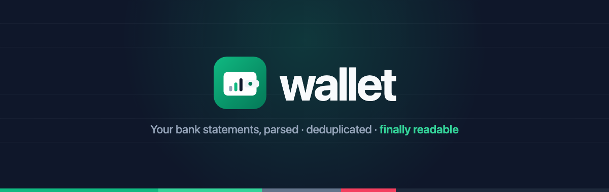
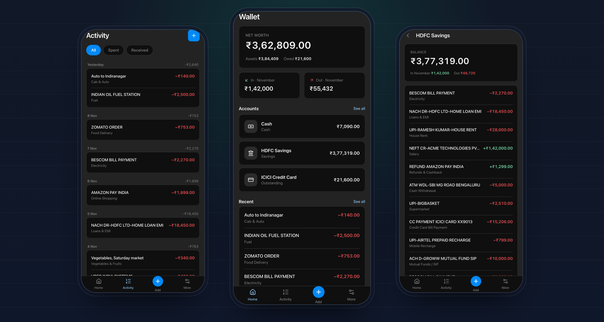
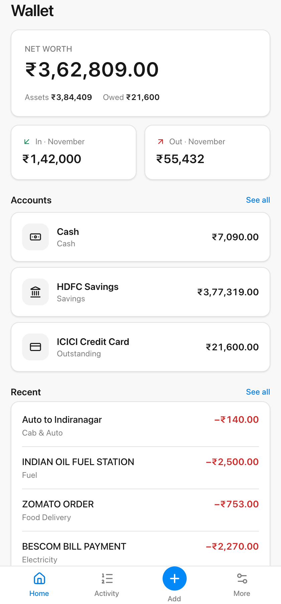
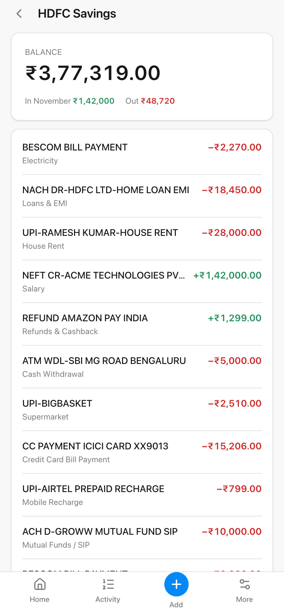
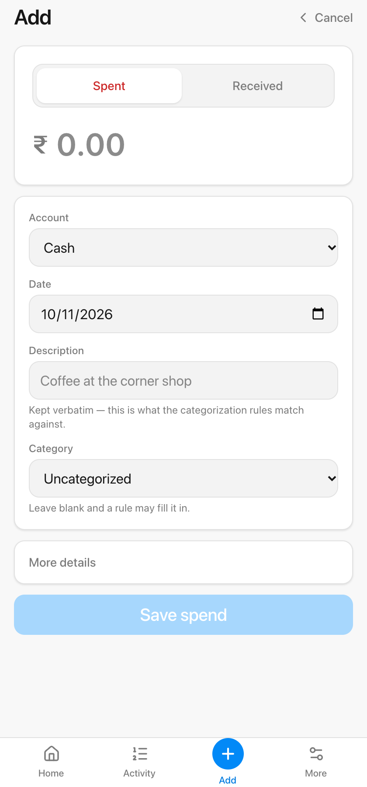

<p align="center">
  
</p>

<p align="center">
  
  
  
  
  
</p>

<p align="center">
  <a href="https://wreckage0907.github.io/wallet/">Website</a> ·
  <a href="docs/">Docs</a> ·
  <a href="https://github.com/wreckage0907/wallet/issues">Support</a> ·
  <a href="https://wreckage0907.github.io/wallet/privacy.html">Privacy</a> ·
  <a href="https://wreckage0907.github.io/wallet/terms.html">Terms</a>
</p>

<p align="center">
  <samp>
    Personal finance for Frappe. Add your bank accounts, drop in the statement files your bank emails you,<br>
    and Wallet parses, de-duplicates and categorizes every row &mdash; then shows you where the money went, on your phone.
  </samp>
</p>

<p align="center">
  
</p>

<samp>

> Built for Indian retail banking: `dd/mm` dates, `Dr`/`Cr` suffixes, running-balance columns,
> password-protected xlsx, and out-of-the-box rules for Swiggy, Zomato, FASTag, NACH EMIs and salary credits.

</samp>

<br>

# ⚙️ Installation

<table>
<tr>
<td width="50%" valign="top">

<samp>

**📝 Prerequisites**

1. **Frappe Bench** with a **v16.53+** site
2. **Python 3.14** (what Frappe v16 itself requires)
3. **Node 24+** and **yarn**
4. **MariaDB** (via bench)

<br>

**🔮 Optional**

- An MCP client, to let an AI agent read your accounts

</samp>

</td>
<td width="50%" valign="top">

<samp>

**🪴 Usage**

1. Install the app and build its assets:

       bench get-app https://github.com/wreckage0907/wallet --branch main
       bench --site <site> install-app wallet
       bench build --app wallet

2. Give yourself the **Wallet User** role.

3. Open it:

       /wallet        the PWA
       /desk/wallet   the desk workspace

</samp>

</td>
</tr>
</table>

<br>

# ✨ Features

<table>
  <tr>
    <td width="50%" valign="top"><samp>
      <b>Statement import that survives real bank files</b>
      <br><br>
      Point it at the xlsx your bank emailed you &mdash; encrypted, with branch details above the table and a totals row below. Wallet finds the table, works out which column is which, and stages every row for review before a single transaction is written.
    </samp></td>
    <td width="50%" valign="top"><samp>
      <b>De-duplication across overlapping statements</b>
      <br><br>
      Each transaction is fingerprinted from its own content &mdash; reference number, or date + amount + narration disambiguated by the running balance. Re-importing an overlapping month is a no-op.
    </samp></td>
  </tr>
  <tr>
    <td width="50%" valign="top"><samp>
      <b>Auto-categorization from your own rules</b>
      <br><br>
      Ships with ~20 rules tuned for Indian bank narrations and a two-level category tree. Rules match description, counterparty or reference by substring, prefix, exact match or regex.
    </samp></td>
    <td width="50%" valign="top"><samp>
      <b>Balances that cannot drift</b>
      <br><br>
      A balance is always <code>opening_balance + SUM(signed_amount)</code>, never a counter incremented in place. Accounts in different currencies are totalled separately, never silently added together.
    </samp></td>
  </tr>
  <tr>
    <td width="50%" valign="top"><samp>
      <b>A reconciliation number you can trust</b>
      <br><br>
      After an import, Wallet compares its computed closing balance with the one the statement states. One number checks parsing, sign convention and de-duplication at once.
    </samp></td>
    <td width="50%" valign="top"><samp>
      <b>An MCP server, with writes off by default</b>
      <br><br>
      Ask your AI assistant what you spent on groceries last month, or have it record a cash payment. Writes need both the site admin and you to switch them on, and the gate holds on every Wallet document.
    </samp></td>
  </tr>
</table>

<br>

# 📱 Preview

<table>
  <tr>
    <td width="33%"></td>
    <td width="33%"></td>
    <td width="33%"></td>
  </tr>
  <tr>
    <td width="33%" align="center" valign="top"><samp>
      <b>Everything in one number</b>
      <br><br>
      Net worth, this month's money in and out, and every account balance &mdash; in two queries, not one per account.
    </samp></td>
    <td width="33%" align="center" valign="top"><samp>
      <b>A statement, categorized</b>
      <br><br>
      Salary, rent, EMI, SIP and card bill, each filed by a rule the moment the statement was imported.
    </samp></td>
    <td width="33%" align="center" valign="top"><samp>
      <b>Four taps for cash</b>
      <br><br>
      The things no statement sees. Leave the category blank and the same rules fill it in.
    </samp></td>
  </tr>
</table>

<br>

# 🚀 Getting started

<samp>

| | Step | What happens |
|---|---|---|
| **1** | **Wallet › Wallet Account › New** | Name it, pick a type, and set the opening balance and the date it was true as of. |
| **2** | **Wallet › Import Statement › New** | Pick the account, attach the file, and enter the password if your bank encrypts it. |
| **3** | **Parse Statement** | Every row is staged as New, Duplicate or Error. Review it; nothing is written yet. |
| **4** | **Import N Rows** | The reviewed rows become transactions, and the variance tells you whether they add up. |
| **5** | **Open `/wallet` on your phone** | Install it to the home screen. Categories and rules are already there. |

To let an AI agent read your accounts, point an MCP client at the site's built-in endpoint:

```sh
claude mcp add --transport http wallet https://<your-site>/api/v2/mcp
```

It opens your normal Frappe login and receives a token once you approve. There is no API key to copy.

</samp>

<br>

# 📚 Docs

<samp>

| Guide | Covers |
|---|---|
| [Importing statements](docs/importing-statements.md) | The full import flow, saved formats, default categories, and reading the reconciliation |
| [How it works](docs/how-it-works.md) | Data model, per-user isolation, the import pipeline, and the three de-duplication tiers |
| [MCP server](docs/mcp.md) | Wallet's tools, the two-switch write gate, setup and verifying a connection |
| [Specs](specs/README.md) | Working notes: open audit findings, security boundaries, development and testing |

</samp>

<br>

<hr>

<p align="center">
  <samp>
    MIT &middot; built on <a href="https://frappeframework.com">Frappe</a>
  </samp>
</p>
