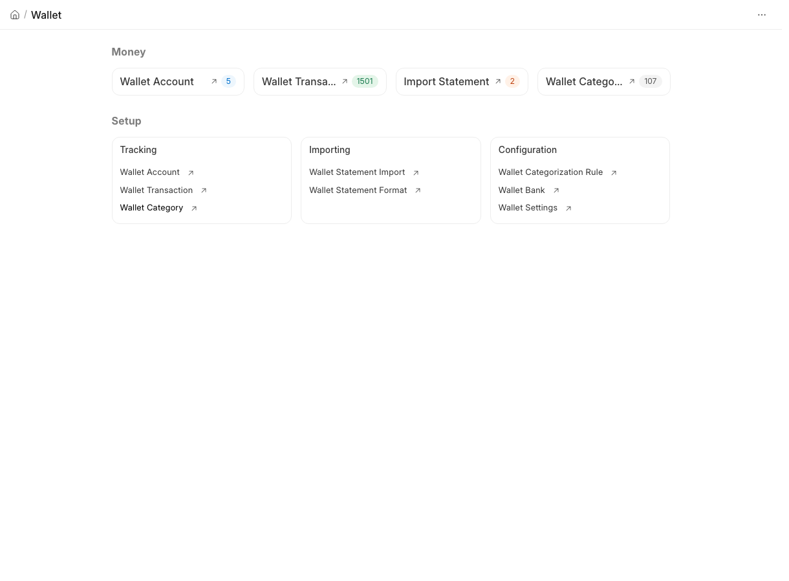
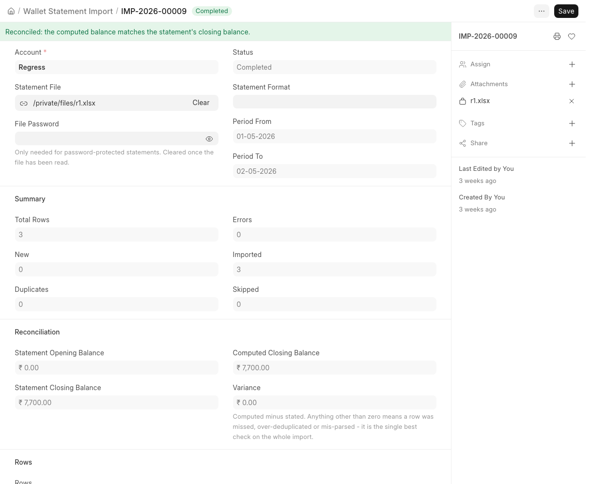
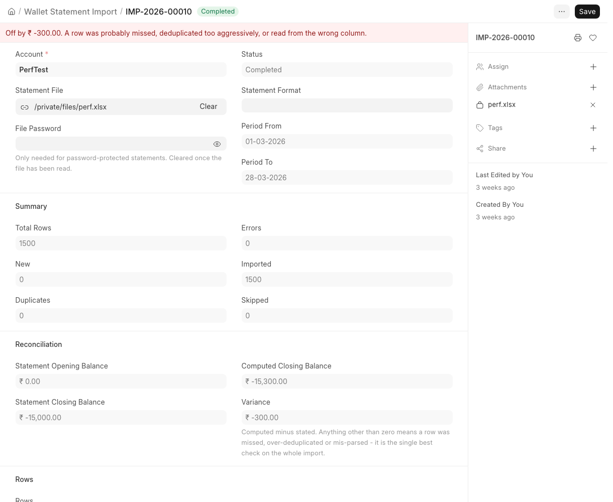

# Importing statements

Wallet has two faces. The PWA at `/wallet` is for the day to day — mobile-first,
installable, works offline, and it records a transaction in about four taps. The Frappe desk
at `/desk/wallet` is for the heavier work: creating accounts, running imports, editing
categorization rules.

  

## The flow, step by step

| | Step | What happens |
|---|---|---|
| **1** | **Wallet › Wallet Account › New** | Name it, pick a type, set the opening balance and the date it was true as of. Transactions dated before the opening date are rejected rather than silently dropped from the balance. |
| **2** | **Wallet › Import Statement › New** | Pick the account, attach the file, enter the password if your bank encrypts it. |
| **3** | **Parse Statement** | Wallet finds the header row, maps the columns, parses every row and marks each one New, Duplicate or Error. |
| **4** | **Review the preview** | Fix a category, skip a row. Nothing is written yet. If a column was mapped wrong, correct the mapping and re-parse — never hand-edit the values. |
| **5** | **Import N Rows** | Each row commits in its own savepoint, so one bad row cannot take the batch down. Check the variance afterwards. |
| **6** | **Save as Format** *(optional)* | Wallet remembers the layout by its header signature, so the next statement from the same bank skips steps 3 and 4. |

Your categories and rules are seeded per user the first time you use the app. Deleting or
renaming one sticks — they are defaults, not fixtures. **More › Restore default categories**
brings back anything you deleted and want again, leaving your renames alone.

## Reconciliation

After an import, the reconciliation block compares Wallet's computed closing balance against
the one the statement states.

<table>
  <tr>
    <td width="50%"></td>
    <td width="50%"></td>
  </tr>
  <tr>
    <td width="50%" align="center" valign="top">
      <b>✅ Reconciled</b>
        
      Variance is zero. Every row parsed, signed and de-duplicated correctly.
    </td>
    <td width="50%" align="center" valign="top">
      <b>⚠️ Off by ₹300</b>
        
      1,500 rows imported and it still says so, instead of letting a mis-parsed row pass quietly.
    </td>
  </tr>
</table>
